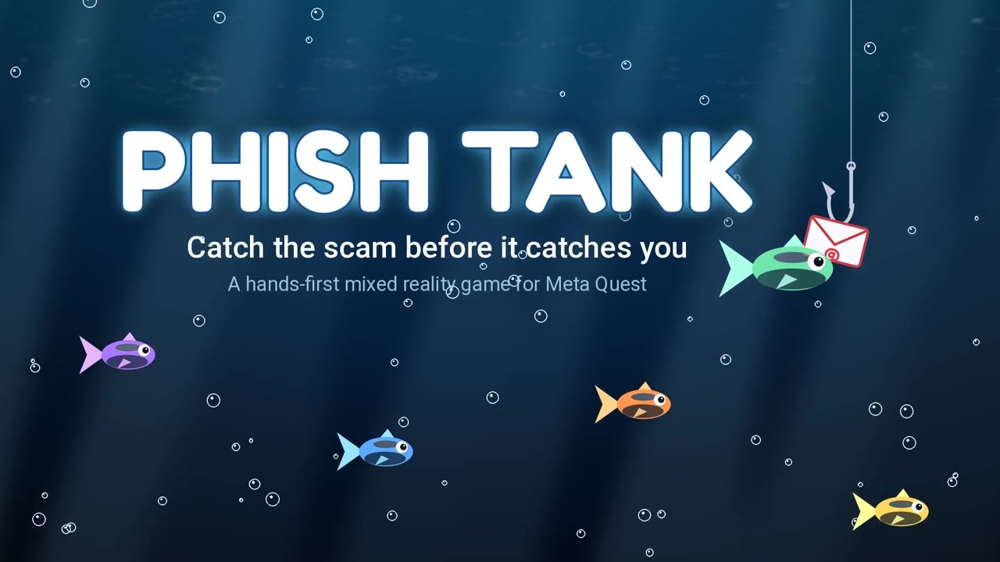
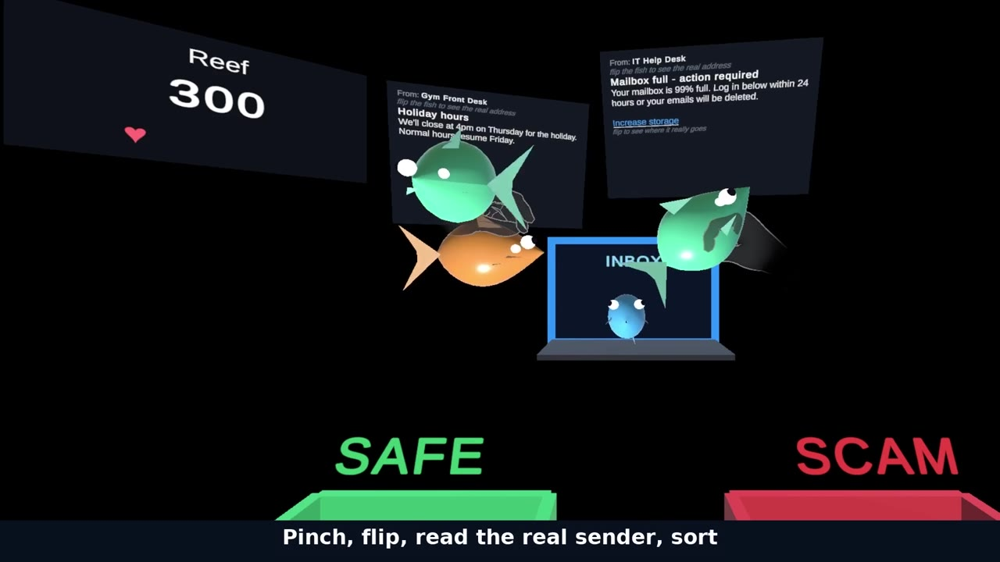

<p align="center">
  
</p>

# Phish Tank 🐟

**A hands-first mixed reality game for Meta Quest that teaches you to spot phishing emails.**

Suspicious emails swim around your real room as fish. Pinch one with your bare hand, flip it over to see the *real* sender and where the link *really* goes, then throw it into **SAFE** or **SCAM**. Every sort teaches one real-world clue, and your aquarium grows as you get better.

- ▶️ **Demo video:** https://youtu.be/o61LMfW7AO4
- 🏆 **Devpost:** https://devpost.com/software/phish-tank
- Entry for the **Meta VR Start Developer Competition 2026** – Gaming track, New division

<p align="center">
  
</p>

## Why

Phishing is still the most common way people get hacked, and most security training is a boring slideshow. Phish Tank turns the habits that actually protect you – checking the real sender, hovering a link, distrusting urgency – into a physical, playful motion you remember.

## How to play

1. **Grab** a fish with a pinch – its email card opens.
2. **Flip** the fish (turn your hand over) to reveal the real address and the real link destination.
3. **Throw** it: left into the green **SAFE** inbox, right into the red **SCAM** net.
4. Get instant feedback with the clue you caught (or missed) and a one-line lesson.
5. Clear 5 levels – Tide Pool → Reef → Kelp Forest → Open Sea → The Deep – with 3 lives, combos and a daily streak.

**Clues players learn:** urgency and threats, password or 2FA requests, lookalike domains (`parce1point`), link text that doesn't match the URL, reading domains from the right (`bank.com.secure-login.net`), dangerous attachments (`.docm`, `.pdf.exe`), gift-card requests, and too-good-to-be-true prizes.

All companies and people in the 24 sample emails are **fictional**.

## Features

- **Hands only** – no controllers needed (Meta Interaction SDK grab + hand tracking)
- **Mixed reality** – passthrough, and fish can swim above your real table (MR Utility Kit)
- **Throw assist** – a gentle sideways throw arcs the fish into the right bin, so sorting feels good even for first-time VR players
- **Seated and comfortable** – no locomotion, short 2–3 minute rounds
- **Progress** – aquarium decorations unlock as your correct sorts add up
- **Data-driven content** – add new emails in [`Assets/PhishTank/Data/emails.json`](Assets/PhishTank/Data/emails.json)

## Tech

| | |
|---|---|
| Engine | Unity 6 (6000.6), Universal Render Pipeline |
| XR | Meta XR SDK 209 – Core, Interaction SDK, MR Utility Kit – on OpenXR |
| Platform | Meta Quest (Android, IL2CPP, ARM64) |
| Language | C# |

## Project layout

```
Assets/PhishTank/
  Scripts/     game logic – EmailFish (grab, flip, throw assist), GameManager, FishSpawner,
               SortBin, EmailCard, FeedbackPanel, HUD, TutorialCoach, AquariumGrowth, ...
  Editor/      one-click tools – scene builder, Quest build, OpenXR fix, demo recorder
  Data/        emails.json – all email content
  Levels/      5 LevelConfig assets
  Scenes/      PhishTank.unity – the main scene
```

## Run it yourself

1. Open the project in **Unity 6** with Android build support. The Meta XR packages are restored automatically from `Packages/manifest.json`.
2. Open `Assets/PhishTank/Scenes/PhishTank.unity`.
3. **No headset?** Use the Meta XR Simulator (Meta → Meta XR Simulator → Activate) and press Play.
4. **On a Quest:** enable Developer Mode, connect by USB-C, then **PhishTank → Build Quest APK** (or Build Profiles → Build And Run).
   Release builds are signed with a private key that is not part of this repo; without it Unity falls back to a debug key, which is fine for testing on your own headset.

## Author

Built solo by **Aiperi Moldobaeva** – [GitHub @Peri2505](https://github.com/Peri2505)
